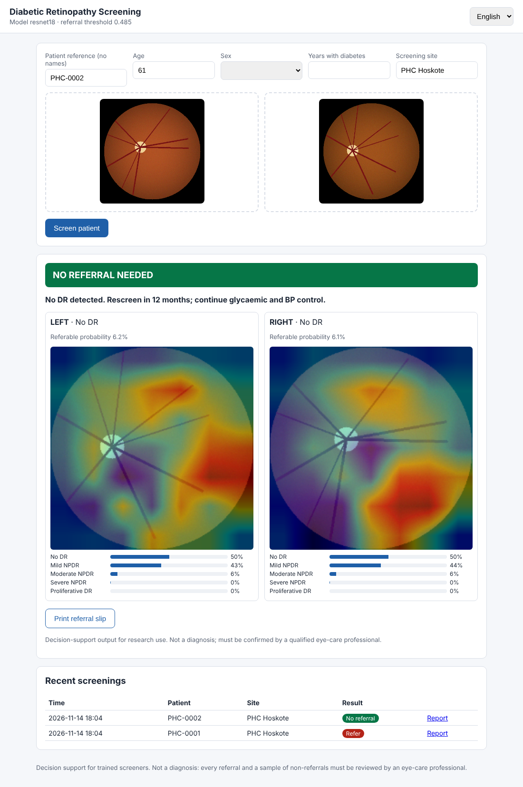
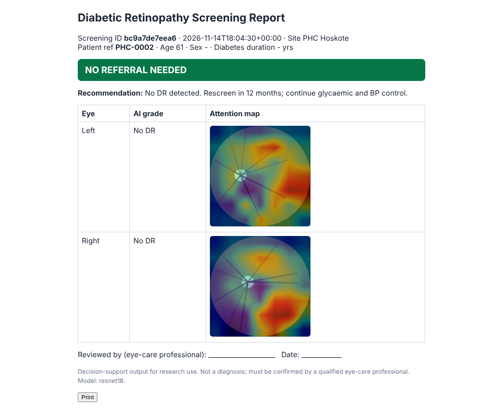

# DR Screening: AI-assisted diabetic retinopathy screening for primary care

An end-to-end, open codebase for screening people with diabetes for
**referable diabetic retinopathy (DR)** from fundus photographs taken by a
technician at a primary health centre or clinic.

> ⚠️ **Research use only.** This is not a certified medical device. Clinical use in
> India requires CDSCO approval as Class C SaMD (see `docs/regulatory_and_privacy.md`).

## What it does

```
Technician captures both eyes
        │
        ▼
 ┌──────────────┐  ungradable  ┌───────────────────────────┐
 │ Quality gate │ ───────────▶ │ Retake / refer if still   │
 └──────┬───────┘              │ ungradable                │
        │ gradable             └───────────────────────────┘
        ▼
 Preprocess (crop, resize, Ben Graham contrast)
        ▼
 CNN (EfficientNet) → ICDR grade 0–4 + P(referable)
        ▼
 Referral threshold tuned for ≥90% sensitivity
        ▼
 Worse eye decides → referral + recommendation + attention heatmap
        ▼
 Printable referral slip · pseudonymous record (SQLite)
```

| Grade | Name | Action (built into the app) |
| --- | --- | --- |
| 0 | No DR | Rescreen in 12 months |
| 1 | Mild NPDR | Rescreen in 6–12 months |
| 2 | Moderate NPDR | **Refer** within 3 months |
| 3 | Severe NPDR | **Urgent referral** within 4 weeks |
| 4 | Proliferative DR | **Urgent referral** within 1–2 weeks |
| — | Ungradable | Retake; refer if still ungradable |

Adjust the intervals to your national or programme guidelines with your clinical partner.

## Repository layout

```
src/drscreen/
  preprocess.py   fundus crop, Ben Graham normalisation, circular mask
  quality.py      image quality gate (blur, exposure, framing, resolution)
  data.py         manifest loading, patient-grouped splits, augmentation, balancing
  model.py        timm backbone + 5-class head, checkpoint I/O
  metrics.py      QWK, referable sensitivity/specificity/AUC with bootstrap CIs
  train.py        training loop, early stopping, threshold tuning at target sensitivity
  evaluate.py     external-test evaluation → metrics.json + report.md
  inference.py    Screener: quality → grade → referral → Grad-CAM heatmap
api/main.py       FastAPI service + SQLite records + printable report
app/static/       technician web app (mobile-friendly, English/Hindi)
scripts/          prepare_dataset.py (APTOS/EyePACS/IDRiD/Messidor-2/folders), make_synthetic_data.py
configs/          default.yaml (real training), smoke.yaml (offline CPU test)
docs/             clinical validation plan, regulatory & privacy, roadmap
tests/            unit + API end-to-end tests
```

## Quick start (about 10 minutes, offline, on CPU)

```bash
pip install torch torchvision --index-url https://download.pytorch.org/whl/cpu
pip install -r requirements.txt
make test     # 5 tests
make smoke    # synthetic images → train → evaluate (pipeline check only)
DR_MODEL=runs/smoke/best.pt make serve   # open http://localhost:8000
```

The synthetic images only exercise the pipeline. They are not medical data, and
the smoke model is meaningless clinically.

## Train a real model

1. **Get data.** Use the public datasets (check their licences) plus de-identified
   images from your partner hospital:
   - APTOS 2019 (Indian, Aravind Eye Hospital), about 3.7k images
   - EyePACS / Kaggle DR 2015, about 88k images
   - IDRiD (Indian), 516 images, which makes a good external test set
   - Messidor-2 (adjudicated grades), 1,748 images, another good external test set
2. **Build manifests.**
   ```bash
   python scripts/prepare_dataset.py eyepacs --labels trainLabels.csv --images train/ --out data/eyepacs.csv
   python scripts/prepare_dataset.py aptos   --labels train.csv --images train_images/ --out data/aptos.csv
   # concatenate the training sources into data/manifest.csv; keep IDRiD/Messidor-2 as data/test.csv
   ```
3. **Train** on a GPU. A single T4 or A10 is enough, and an EfficientNet-B3 at
   512px takes a few hours on EyePACS + APTOS.
   ```bash
   make train                                  # or override values:
   PYTHONPATH=src python -m drscreen.train --set train.epochs=25 model.backbone=convnext_tiny
   ```
   Outputs go to `runs/default/`: `best.pt` (weights, config and frozen referral
   threshold), `history.csv` and `val_metrics.json`.
4. **Evaluate externally** and read `runs/default/test/report.md`.
   ```bash
   make eval
   ```
5. **Deploy.**
   ```bash
   make docker    # serves on :8000 using runs/default/best.pt
   ```

## API

| Method | Path | Purpose |
| --- | --- | --- |
| GET | `/health` | Service and model status |
| POST | `/api/screenings` | multipart: `patient_ref`, `age`, `sex`, `diabetes_years`, `site`, `left_eye`, `right_eye` |
| GET | `/api/screenings` | Recent screenings |
| GET | `/api/screenings/{id}` | Full result including heatmaps |
| GET | `/api/screenings/{id}/report` | Printable referral slip |

```bash
curl -F patient_ref=PHC-0001 -F age=58 -F right_eye=@od.jpg -F left_eye=@os.jpg http://localhost:8000/api/screenings
```

## Design decisions

- **Optimise for sensitivity.** The referral threshold is chosen on validation to
  hit `target_sensitivity` (default 0.90). A missed referral costs far more than an
  extra one.
- **Ungradable means referral.** Patients with poor images are never quietly passed.
- **Worse eye decides,** as in standard screening programmes.
- **Grouped splits by patient** prevent leakage between both eyes of one person.
- **Heatmaps** let the reviewing doctor see what the model looked at. They support
  trust and auditing; they are not a diagnosis.
- **Privacy by default.** Only pseudonymous references are stored, images aren't
  kept, and the model runs locally.

## Known gaps (see `docs/roadmap.md`)

- No macular oedema output yet. It's the top item on the backlog and essential for
  real "referable" status.
- No login, roles, HTTPS or audit log. These must be added before any pilot.
- Quality-gate thresholds must be calibrated per camera.
- No offline/edge build yet (ONNX/int8 is planned).

## Next steps

1. Sign a data and clinical partnership with an eye hospital.
2. Train on EyePACS + APTOS, then validate externally on IDRiD and Messidor-2.
3. Follow `docs/clinical_validation_plan.md` for the silent pilot.

## Screenshots (smoke model on synthetic images)



